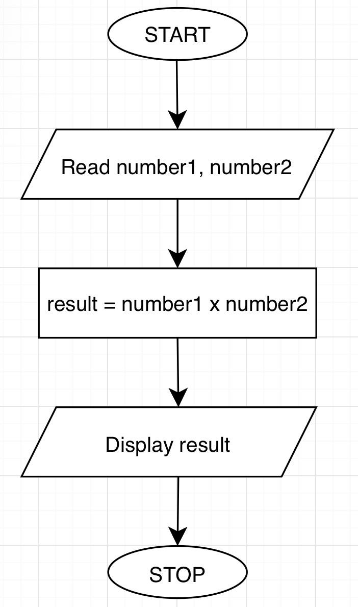
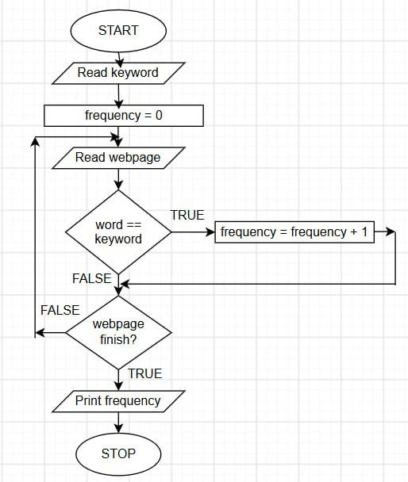

# Tutorial 01 — Answers

## Part I

### Question 1
| Aspect | Explaination |
| :--- | :--- |
| **Input** | number1, number2 |
| **Process** | multiply the numbers: number1 x number2 |
| **Output** | result of the multiplication |

```text

START
READ number1, number2
CALCULATE result = number1 * number2
DISPLAY result
STOP

```



### Question 2

| **Input** | **Process** | **Output** |
| :--- | :--- | :--- |
| A random number | compare the number with 50 | State whether the number is greater/less/equal to 50 |

```text
START
READ number
IF number > 50 THEN
    PRINT number + "is greater than 50."
ELSE IF number < 50
    PRINT number + "is less than 50."
ELSE 
    PRINT number + "is equal to 50."
END IF
STOP
```


### Question 3

| **Input** | **Process** | **Output** |
| :--- | :--- | :--- |
| values of mark | compare the mark with 40 | State whether the  grade |

```text
START
READ mark
IF mark >= 40
    result = Pass
ELSE
    result = Fail
END IF
DISPLAY result
STOP
```


### Question 4

| **Input** | **Process** | **Output** |
| :--- | :--- | :--- |
| values of dice1, dice2 | compare dice1, dice2 | state the winner |

```text
START
READ dice1, dice2
IF dice1 < dice2
    PRINT "Player 2 wins"
ELSE IF dice1 > dice2
    PRINT "Player 1 wins"
ELSE 
    PRINT "The resultis tie"
END IF
STOP
```


### Question 5
| **Input** | **Process** | **Output** |
| :--- | :--- | :--- |
| height, width | perimeter = (2 x length) + (2 x width) | perimeter |

```text
START
READ height, width
CALCULATE perimeter = (2 x length) + (2 x width)
DISPLAY perimeter
STOP
```


### Question 6

| **Input** | **Process** | **Output** |
| :--- | :--- | :--- |
| none  | assign first number as the minimum, compare each new number with the min number and update it | minimum number |

```text
START
GENERATE random number
SET as min_number
FOR (i = 1, i < 10, i++)
    Genarate a new number
    number[i] = current_number

    IF current_number < min_number
        min_number = current_number
    END IF
END FOR
STOP
```


### Question 7

| **Input** | **Process** | **Output** |
| :--- | :--- | :--- |
| none | classify even and odd number | numbers of even and odd numbers |

```text
START
SET evencount = 0
SET oddcount = 0
WHILE (int = 0, i <= 0, i++)
    GENERATE random number between 10 to 100

    IF (num % 2 == 0 ) THEN
        evencount = evencount + 1
    ELSE 
        oddcount = oddcount + 1
    END IF
STOP
```


## Part II

### Question 8

| **Input** | **Process** | **Output** |
| :--- | :--- | :--- |
| sentence | Read each character in the sentence and count the number of u and m | number of U and M |

```text
START
READ sentence
SET count_u = 0, count_m = 0
Initialise an index that points to the first char of the sentence

WHILE each character in sentence DO
    IF character == 'U' or character == 'u' THEN
        count_u = count_u + 1
    ELSE IF character == 'M' or character == 'm'
        count_m = count_m + 1
    END IF 
END WHILE
PRINT count_u and count_m
STOP
```


### Question 9

| **Input** | **Process** | **Output** |
| :--- | :--- | :--- |
| keyword | Read the webpage, compare each word with keyword, count if it matches | frequency of the keyword |

```text
START
READ keyword
READ webpageText
SET frequency = 0

FOR each word in webpageText
    IF word == keyword THEN
        frequency = frequency + 1
    END IF
END FOR
PRINT frequency
STOP
```


